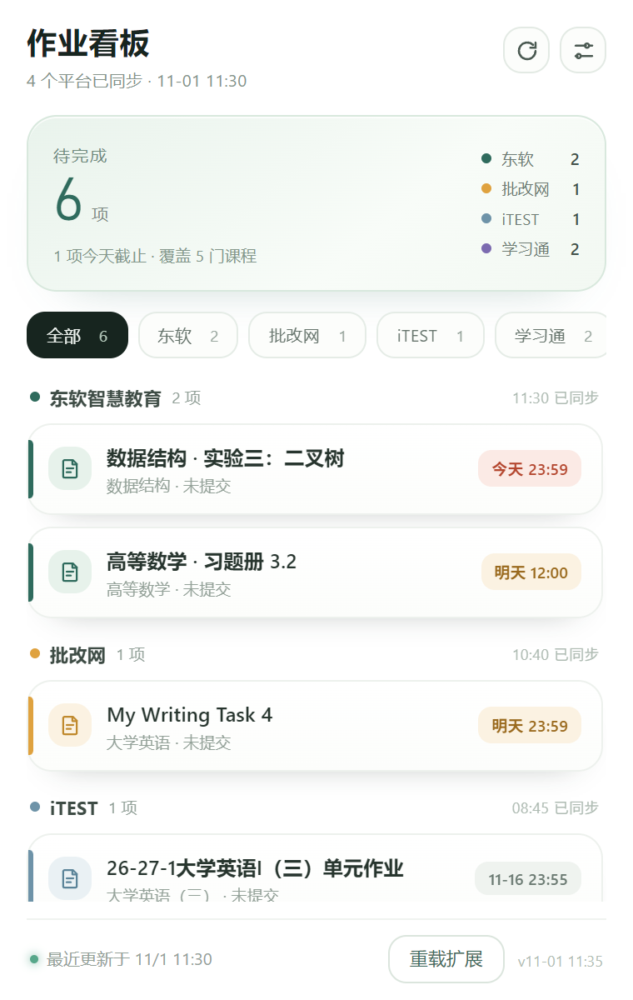
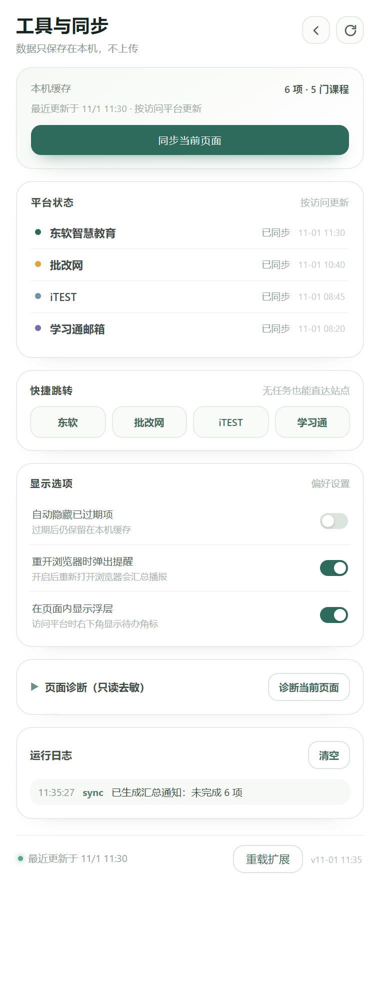

# 作业整合看板（Assignment Integration Dashboard）

一个基于 **WXT + React + TypeScript + Manifest V3** 的浏览器扩展：把多个教学平台里明确标记为「未提交 / 作答中」的作业汇总到同一块看板，按平台分组、按截止时间标注紧急度，减少在多个平台之间来回切换、漏看作业。

> 数据默认只保存在本机（`browser.storage.local`），不向任何云端或第三方上传。

## 界面预览

| 主看板 | 工具与同步 |
|---|---|
|  |  |

> 截图为演示数据，实际内容来自各平台同步结果。弹窗宽 380px、看板上限 600px，列表在内部滚动，汇总卡与底部同步状态保持可见。

## 功能特性

- **多平台汇总**：已接入 4 个平台的真实解析器，按平台访问触发同步；未访问的平台保留上次成功同步的数据。
- **分组看板**：按平台分组，组内按截止时间由近到远排序；「今天 / 明天 / 之后 / 已过期」用不同颜色的截止徽章标记，平台色只做小圆点，不抢状态信息。
- **汇总卡**：首屏直接回答「几项未完成、几项今天截止、覆盖多少课程」，并展示各平台待办分布。
- **平台筛选与空态自检**：可按平台筛选；空看板会区分「确实没有待办」和「尚未同步 / 待验证」，避免误以为同步失败。
- **工具与同步页**：本机缓存概览、平台状态、快捷跳转、学习通逐课同步、显示选项开关、页面诊断与运行日志集中在一处。
- **启动汇总通知**：Edge/Chrome 启动时若本机有未完成作业，显示一条汇总通知（含总数与最近同步时间），不触发后台轮询。
- **启动自动重同步**：浏览器启动时对后台已打开的平台标签页主动触发一次同步（仅覆盖已打开的标签，见「已知限制」）。
- **状态诚实**：仅纳入平台明确标记为「未提交 / 作答中」的作业；不凭截止时间臆测提交状态，无法确认的页面静默跳过、不覆盖历史缓存。
- **自动隐藏已过期项**：全局开关，把已过期的未提交作业折叠（数据仍保留，便于需要时展开）。
- **页面诊断**：可回传当前页 hostname / 文本 / 请求等证据，便于排查解析异常（隐私敏感字段已去敏）。

## 支持平台

| 平台 | 入口域名 | 解析状态 |
|---|---|---|
| 东软智慧教育 | `study.neusoft.edu.cn` | 真实解析（仅纳入平台标记的「作答中 / 未作答」） |
| 批改网 | `pigai.org` / `www.pigai.org` | 真实解析（学生端「我的作文」→「未完成」分桶） |
| iTEST | `sso.unipus.cn` / `itestcloud.unipus.cn` | 真实解析 |
| 学习通邮箱 | `i.chaoxing.com`（收件箱渲染于 `notice.chaoxing.com` 跨域 iframe） | 真实解析（收件箱消息 + 考试「注意时间」判定） |

学习通邮箱判定规则：

1. 收件箱消息标题以「作业」开头且非「作业结束提醒」→ 计入待办；
2. 「考试通知」计入待办，并读取详情页的「开始 / 结束时间」，按结束时间判定是否已过期；
3. 收件箱支持自动翻页（上限 20 页，跨页按消息 ID 去重）。

## 安装与加载

本仓库是**源码仓库**，需先构建；也可以使用仓库 Releases 中提供的预构建包（若提供）。

### 方式一：从源码构建并加载

```bash
cd extension
npm install
npm run build
```

构建产物在 `extension/.output/chrome-mv3/`。然后在浏览器中加载：

1. 地址栏打开 `chrome://extensions`（Edge 为 `edge://extensions`）；
2. 右上角开启「开发者模式」；
3. 点击「加载已解压的扩展程序」；
4. 选择 `extension/.output/chrome-mv3/` 目录；
5. 固定扩展图标，点击弹窗即可使用。

需要分发给别人时，可先执行 `npm run zip`，在 `extension/.output/` 下得到可直接分发的扩展 zip：

```
extension/.output/assignment-integration-dashboard-0.1.0-chrome.zip
```

解压后选择包含 `manifest.json` 的那一层文件夹加载即可。

> 不修改源码、只更新数据时，可直接在 `chrome://extensions` 对该扩展点「重新加载」。

### 方式二：使用预构建包（如 Release 提供）

在仓库 **Releases** 页下载扩展 zip，解压后按方式一步骤 1–5 加载解压出的目录，无需 `npm install`。

## 使用方法

1. 在 Edge/Chrome 中登录各教学平台（扩展复用你已有的登录会话，不在工具内重复输入密码）；
2. 打开任一已接入平台的页面，扩展自动读取并更新该平台数据，看板同步刷新；
3. 点击扩展图标打开看板：
   - 顶部汇总卡查看未完成总数、今日截止与平台分布；
   - 用平台筛选快速收敛列表；
   - 每张作业卡片显示课程/状态与截止徽章，点击直达原作业页面；
   - 右上角「刷新」同步当前平台，齿轮图标进入「工具与同步」；
4. 在工具页可查看平台状态、逐课同步学习通课程、切换显示选项；
5. 排查解析问题时，在工具页展开「页面诊断」，或在底栏使用「重载扩展」让新构建立即生效。

## 开发

环境要求：Node.js 18+（WXT 0.21 推荐 20+）。

```bash
cd extension
npm install          # 安装依赖（含 WXT、React、TypeScript）
npm run dev          # 开发模式，自动重载
npm run build        # 生产构建，输出到 .output/chrome-mv3
npm run zip          # 打包可分发的扩展 zip，输出到 .output/
npm run compile      # 仅类型检查（tsc --noEmit，strict 模式）
npm test             # 运行平台解析器单元测试（src/*.test.ts）
```

> 注意：源码改动必须在 `extension/` 内 `npm run build` 后，于 `chrome://extensions`「重新加载」扩展才会生效。

## 项目结构

```
extension/
├── entrypoints/        # 扩展入口
│   ├── background.ts   # 后台：同步、通知、角标
│   ├── content.ts      # 内容脚本：平台页面解析与浮层
│   └── popup/          # 弹窗 UI（React）
│       ├── App.tsx
│       ├── App.css
│       └── style.css
├── src/                # 平台解析器与核心逻辑
│   ├── platforms.ts    # 平台适配器注册与路由
│   ├── models.ts       # 数据模型、平台标签/域名、存储结构
│   ├── neusoft.ts      # 东软智慧教育解析器
│   ├── pigai.ts        # 批改网解析器
│   ├── itest.ts        # iTEST 解析器
│   ├── chaoxing.ts     # 学习通邮箱解析器（含考试「注意时间」判定）
│   ├── chaoxing-crawl.ts # 学习通逐课同步
│   ├── diagnose.ts     # 页面诊断取证
│   ├── storage.ts      # 本机存储层
│   ├── log.ts          # 运行日志
│   └── *.test.ts       # 各解析器单元测试
├── document/           # 需求、方案、交接与判定规则文档
├── public/             # 静态资源（图标等）
├── wxt.config.ts       # WXT 配置（host 权限、content script 注入）
└── package.json
```

## 数据与隐私

- 面向单人使用；默认在本机保存作业清单、平台配置与同步时间。
- 不要求重新输入平台密码；仅读取你已登录并访问的页面。
- 日志中不记录明文密码、会话令牌等凭据。
- 你可随时清除本机保存的数据与平台登录配置。

## 已知限制

- **启动自动重同步仅覆盖「已打开」的标签页**：受浏览器安全模型限制，扩展读不到未打开页面的 DOM，因此浏览器启动时只对后台已打开的平台标签页触发同步；从未打开过的平台仍需访问一次才会进入看板。
- **学习通邮箱翻页上限 20 页**：自动逐页累加未处理通知；分页控件缺失或无「下一页」时仅处理当前页。
- **学习通考试的「交卷成功」状态不自动核验**：进入真正考试页存在误触发答题/交卷的风险，故以「注意时间」（结束时间）作为唯一自动化信号；是否已交卷需你在平台手动确认。
- 各平台页面结构可能随学校/账号配置变化；解析失败时保留历史数据并标注同步异常（状态置为「待验证」并写明缺失的选择器），而不是误报或静默清空缓存。

## 许可证

本项目采用 [MIT 许可证](./LICENSE)（Copyright © 2026 原木）。允许任何人免费使用、复制、修改、分发本软件，仅需保留版权声明与许可声明；软件按「原样」提供，不附带任何担保。
